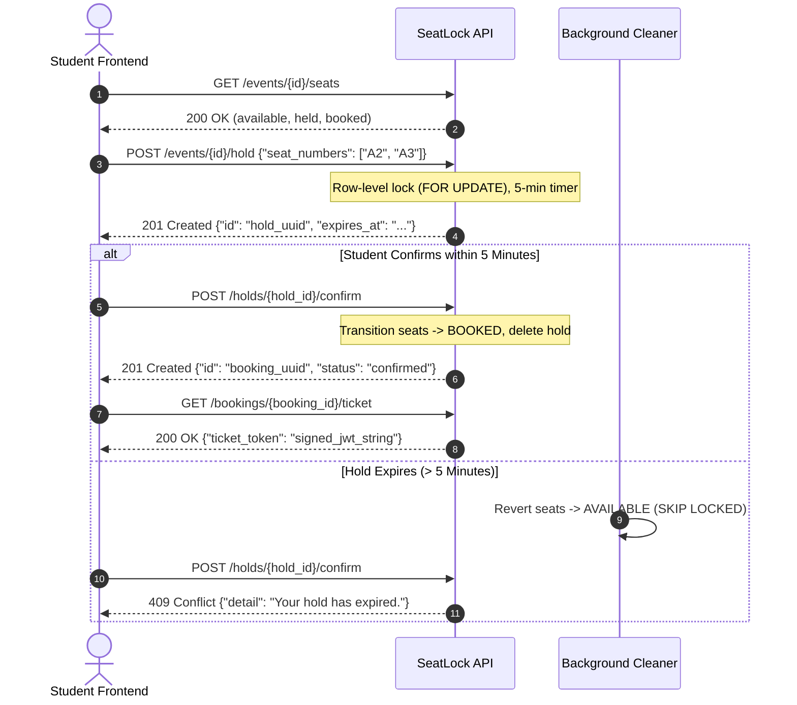

# SeatLock — Frontend Integration Guide

This document is the definitive integration reference for frontend engineers connecting client applications to the **SeatLock** FastAPI backend.

---

## 1. Quick Start & Server Setup

### Start Backend Development Server
Run from the `backend/` directory with the virtual environment activated:
```bash
# In c:\Hackathon\ai-project\backend
..\.venv\Scripts\uvicorn app.main:app --reload --host 127.0.0.1 --port 8000
```
- **Base API URL:** `http://127.0.0.1:8000`
- **Interactive Swagger Docs:** `http://127.0.0.1:8000/docs`
- **OpenAPI Schema:** `http://127.0.0.1:8000/openapi.json`
- **Health Check:** `GET http://127.0.0.1:8000/health`

### Seed Demo Data for UI Development
To populate the database with test users, sample events (40 seats and 20 seats), and active bookings for immediate UI rendering:
```bash
# In c:\Hackathon\ai-project\backend
..\.venv\Scripts\python scripts\seed_demo_data.py
```
*(Guaranteed safe and idempotent: never resets or deletes existing records).*

---

## 2. Authentication & Cookie Session Model

SeatLock uses **HttpOnly, SameSite signed JWT cookies**. The frontend does not need to store tokens in `localStorage`.

### Browser Request Requirements
For cross-origin calls (e.g. frontend on `http://localhost:3000` or `5173` talking to `http://127.0.0.1:8000`):
- **Fetch API:** Always pass `credentials: "include"`.
  ```javascript
  const res = await fetch("http://127.0.0.1:8000/events", {
    credentials: "include",
    headers: { "Content-Type": "application/json" }
  });
  ```
- **Axios:** Set `axios.defaults.withCredentials = true;`.

### Pre-Configured Test Credentials

| Role | Username | Password | Permitted Actions |
| :--- | :--- | :--- | :--- |
| **Student** | `student_user` | `StudentPass123!` | View seat map, hold 1–4 seats, confirm holds, view own tickets, cancel own bookings. |
| **Organizer** | `organizer_user` | `OrganizerPass123!` | Create events, update owned events, view attendee manifests for owned events, gate check-in. |
| **Admin** | `admin_user` | `AdminPass123!` | Global administration across all events, query audit log shards, elevated gate check-in. |

---

## 3. Complete API Endpoint Matrix

| Method | Path | Auth Required | Role | Summary |
| :--- | :--- | :---: | :--- | :--- |
| `POST` | `/auth/login` | No | Any | Authenticate and receive HttpOnly cookie |
| `POST` | `/auth/logout` | No | Any | Clear session cookie |
| `GET` | `/auth/me` | **Yes** | Any | Get current user profile |
| `GET` | `/events` | No | Public | List upcoming events |
| `POST` | `/events` | **Yes** | `organizer`, `admin` | Create new event and initialize venue seats |
| `GET` | `/events/organizer/mine` | **Yes** | `organizer`, `admin` | List events owned by calling organizer |
| `GET` | `/events/{event_id}` | No | Public | Get single event details |
| `PUT` | `/events/{event_id}` | **Yes** | `organizer`, `admin` | Update event details with OCC `version` check |
| `GET` | `/events/{event_id}/seats` | Optional | Public / Student | Real-time seat map (`available`, `held`, `booked`) |
| `POST` | `/events/{event_id}/hold` | **Yes** | `student`, Any | Temporarily hold 1–4 seats for 5 minutes |
| `POST` | `/holds/{hold_id}/confirm` | **Yes** | `student`, Any | Confirm active hold into permanent booking |
| `GET` | `/bookings/me` | **Yes** | Any | List calling user's bookings |
| `GET` | `/bookings/{booking_id}` | **Yes** | Owner / Admin | View specific booking details |
| `POST` | `/bookings/{booking_id}/cancel` | **Yes** | Owner / Admin | Cancel booking and release seats |
| `GET` | `/bookings/{booking_id}/ticket` | **Yes** | Owner / Admin | Get signed QR ticket token string |
| `GET` | `/events/{event_id}/attendees` | **Yes** | Event Owner / Admin | Get attendee manifest and check-in metrics |
| `POST` | `/events/{event_id}/check-in` | **Yes** | Event Owner / Admin | Gate check-in via QR token or booking ID |
| `POST` | `/bookings/{booking_id}/check-in` | **Yes** | Event Owner / Admin | Direct gate check-in by booking ID |
| `GET` | `/audit-logs` | **Yes** | `organizer`*, `admin` | Query partitioned audit shards |
| `GET` | `/health` | No | Public | Service health status |

*\*Organizers must supply `event_id` and must own that event.*

---

## 4. Endpoints & Payload Specifications

### 4.1 Authentication

#### `POST /auth/login`
- **Request Body:**
  ```json
  {
    "username": "student_user",
    "password": "StudentPass123!"
  }
  ```
- **Response (`200 OK`):**
  Sets `Set-Cookie: seatlock_access_token=...; HttpOnly; SameSite=Lax; Path=/`
  ```json
  {
    "message": "Login successful",
    "user": {
      "id": "4b56a9a7-d291-49fb-88ee-11979e3517e3",
      "username": "student_user",
      "role": "student"
    }
  }
  ```
- **Error (`401 Unauthorized`):**
  ```json
  { "detail": "Invalid username or password" }
  ```

#### `POST /auth/logout`
- **Response (`200 OK`):**
  Clears the session cookie.
  ```json
  { "message": "Logout successful" }
  ```

#### `GET /auth/me`
- **Response (`200 OK`):**
  ```json
  {
    "id": "4b56a9a7-d291-49fb-88ee-11979e3517e3",
    "username": "student_user",
    "role": "student"
  }
  ```

---

### 4.2 Events & Seat Map

#### `GET /events`
- **Query Params:** `skip=0`, `limit=100`
- **Response (`200 OK`):** Array of event objects.
  ```json
  [
    {
      "id": "097bfb66-6671-460f-aba7-77122b3c2bd2",
      "title": "SeatLock Hackathon Tech Summit 2026",
      "description": "Developer summit exploring concurrency and security.",
      "location": "Main Auditorium Hall A",
      "start_time": "2026-11-25T14:00:00Z",
      "booking_close_time": "2026-11-24T14:00:00Z",
      "total_seats": 40,
      "version": 1,
      "created_at": "2026-11-20T08:34:20Z",
      "organizer_id": "a78b4e8e-c381-4b32-8b22-61bfb60034e9"
    }
  ]
  ```

#### `POST /events` *(Organizer / Admin)*
- **Request Body:**
  ```json
  {
    "title": "Spring Hackathon Keynote",
    "description": "Opening keynote and seat reservation.",
    "location": "Hall B",
    "start_time": "2026-12-01T10:00:00Z",
    "booking_close_time": "2026-11-30T23:59:00Z",
    "total_seats": 50
  }
  ```
- **Response (`201 Created`):** Returns the created Event object with `version: 1`.

#### `PUT /events/{event_id}` *(Owner Organizer / Admin)*
- **Optimistic Concurrency Control:** Must include the current `version`.
- **Request Body:**
  ```json
  {
    "title": "Updated Title",
    "description": "Updated description",
    "location": "Hall B",
    "start_time": "2026-12-01T10:00:00Z",
    "booking_close_time": "2026-11-30T23:59:00Z",
    "total_seats": 60,
    "version": 1
  }
  ```
- **Response (`200 OK`):** Event object with incremented `version: 2`.
- **Conflict (`409 Conflict`):** If another user modified the event first:
  ```json
  {
    "detail": "Optimistic lock conflict: Event has been modified concurrently. Your version: 1, Current database version: 2."
  }
  ```

#### `GET /events/{event_id}/seats`
- **Response (`200 OK`):** Real-time venue seating layout.
  ```json
  {
    "event_id": "097bfb66-6671-460f-aba7-77122b3c2bd2",
    "total_seats": 40,
    "available_count": 37,
    "held_count": 0,
    "booked_count": 3,
    "seats": [
      {
        "id": "5df20bf9-1c08-4dab-a87f-e3707251d707",
        "event_id": "097bfb66-6671-460f-aba7-77122b3c2bd2",
        "seat_number": "A1",
        "status": "booked",
        "is_held_by_me": false
      },
      {
        "id": "6af30cd1-2d19-4eab-b87f-f4818362e818",
        "event_id": "097bfb66-6671-460f-aba7-77122b3c2bd2",
        "seat_number": "A2",
        "status": "available",
        "is_held_by_me": false
      }
    ]
  }
  ```
  *(Seat status is strictly one of: `"available"`, `"held"`, `"booked"`).*

---

### 4.3 Seat Reservation Lifecycle (Student Flow)



#### Step 1: Hold 1–4 Seats
`POST /events/{event_id}/hold`
- **Request Body:**
  ```json
  {
    "seat_numbers": ["A2", "A3"]
  }
  ```
- **Response (`201 Created`):**
  ```json
  {
    "id": "8f03c08b-9442-4f01-92db-5c74ebf4ad10",
    "event_id": "097bfb66-6671-460f-aba7-77122b3c2bd2",
    "user_id": "4b56a9a7-d291-49fb-88ee-11979e3517e3",
    "expires_at": "2026-11-20T14:15:00Z",
    "seat_numbers": ["A2", "A3"],
    "message": "Seats successfully held for 5 minutes"
  }
  ```
- **Key Business Rules:**
  - 1 to 4 seats per hold.
  - A student can have only **1 active hold per event**. Creating a new hold automatically replaces and releases the student's previous hold.
  - Total confirmed seats + requested seats cannot exceed 4 per event.
  - If any requested seat is booked or actively held by someone else, returns `409 Conflict` (all-or-nothing rollback).

#### Step 2: Confirm Active Hold
`POST /holds/{hold_id}/confirm`
- **No Request Body Required.**
- **Response (`201 Created`):**
  ```json
  {
    "id": "c689ffb7-6781-444a-8986-6f91357c4694",
    "event_id": "097bfb66-6671-460f-aba7-77122b3c2bd2",
    "user_id": "4b56a9a7-d291-49fb-88ee-11979e3517e3",
    "status": "confirmed",
    "created_at": "2026-11-20T14:11:00Z",
    "seat_numbers": ["A2", "A3"],
    "event_title": "SeatLock Hackathon Tech Summit 2026",
    "checked_in_at": null
  }
  ```

#### Step 3: Get QR Ticket Code
`GET /bookings/{booking_id}/ticket`
- **Response (`200 OK`):**
  ```json
  {
    "booking_id": "c689ffb7-6781-444a-8986-6f91357c4694",
    "ticket_token": "eyJhbGciOiJIUzI1NiIsInR5cCI6IkpXVCJ9.eyJ0eXBlIjoic2VhdGxvY2tfdGlja2V0IiwiYmlkIjoiYzY4OWZmYjctNjc4MS00NDRhLTg5ODYtNmY5MTM1N2M0Njk0IiwiZWlkIjoiMDk3YmZiNjYtNjY3MS00NjBmLWFiYTctNzcxMjJiM2MyYmQyIn0..."
  }
  ```
  *(Frontend renders `ticket_token` as a standard QR code using any QR generator component).*

#### Step 4: (Optional) Cancel Booking
`POST /bookings/{booking_id}/cancel`
- **Response (`200 OK`):**
  ```json
  {
    "id": "c689ffb7-6781-444a-8986-6f91357c4694",
    "status": "cancelled",
    "message": "Booking successfully cancelled and seats released"
  }
  ```

---

### 4.4 Organizer & Venue Check-In Flow

#### `GET /events/{event_id}/attendees` *(Event Owner / Admin)*
Returns real-time manifest and check-in KPIs for the event dashboard:
```json
{
  "event_id": "097bfb66-6671-460f-aba7-77122b3c2bd2",
  "event_title": "SeatLock Hackathon Tech Summit 2026",
  "total_bookings": 2,
  "total_seats_reserved": 3,
  "total_checked_in": 1,
  "pending_check_in": 2,
  "attendees": [
    {
      "booking_id": "4103ef12-f50b-40c4-a779-567fd765acbe",
      "user_id": "4b56a9a7-d291-49fb-88ee-11979e3517e3",
      "username": "student_user",
      "seat_numbers": ["A1"],
      "status": "confirmed",
      "checked_in_at": "2026-11-20T13:04:21Z",
      "created_at": "2026-11-20T13:04:21Z"
    },
    {
      "booking_id": "c689ffb7-6781-444a-8986-6f91357c4694",
      "user_id": "4b56a9a7-d291-49fb-88ee-11979e3517e3",
      "username": "student_user",
      "seat_numbers": ["A2", "A3"],
      "status": "confirmed",
      "checked_in_at": null,
      "created_at": "2026-11-20T14:11:00Z"
    }
  ]
}
```

#### Gate Check-In: `POST /events/{event_id}/check-in`
Supports check-in either by scanning the QR token or providing the `booking_id`:
- **Request Body (Scan Mode):**
  ```json
  {
    "qr_token": "eyJhbGciOiJIUzI1NiIsInR5cCI6IkpXVCJ9..."
  }
  ```
- **Request Body (Manual Booking ID Mode):**
  ```json
  {
    "booking_id": "c689ffb7-6781-444a-8986-6f91357c4694"
  }
  ```
- **Response (`200 OK`):**
  ```json
  {
    "booking_id": "c689ffb7-6781-444a-8986-6f91357c4694",
    "event_id": "097bfb66-6671-460f-aba7-77122b3c2bd2",
    "attendee_username": "student_user",
    "seat_numbers": ["A2", "A3"],
    "checked_in_at": "2026-11-20T14:20:15Z",
    "message": "Attendee successfully checked in."
  }
  ```
- **Duplicate Check-In Rejection (`409 Conflict`):**
  ```json
  {
    "detail": "Duplicate check-in: Booking was already checked in at 2026-11-20T14:20:15Z."
  }
  ```
- **Cancelled/Unconfirmed Booking (`400 Bad Request`):**
  ```json
  { "detail": "Cannot check in: Booking is cancelled." }
  ```
- **Cross-Organizer Protection (`403 Forbidden`):**
  Organizers cannot check in attendees for events they do not own.

---

### 4.5 Audit Trail (Admin / Organizer)

#### `GET /audit-logs`
- **Query Params:**
  - `event_id`: Target event UUID (organizers **must** provide this).
  - `action`: E.g. `SEAT_HOLD`, `BOOKING_CONFIRMED`, `CHECKIN`, `HOLD_EXPIRED`.
  - `limit`: Default `50`, max `500`.
  - `offset`: Pagination offset.
- **Response (`200 OK`):**
  ```json
  {
    "total": 42,
    "limit": 50,
    "offset": 0,
    "entries": [
      {
        "id": "f8f82cdb-d277-4986-9f74-55d07d0024cd",
        "actor_id": "4b56a9a7-d291-49fb-88ee-11979e3517e3",
        "actor_role": "student",
        "event_id": "097bfb66-6671-460f-aba7-77122b3c2bd2",
        "action": "BOOKING_CONFIRMED",
        "details": {
          "booking_id": "c689ffb7-6781-444a-8986-6f91357c4694",
          "seat_numbers": ["A2", "A3"]
        },
        "created_at": "2026-11-20T14:11:00Z",
        "shard_id": 2
      }
    ]
  }
  ```

---

## 5. HTTP Status Code Conventions

| Status Code | Meaning | Typical Frontend Handling |
| :---: | :--- | :--- |
| **`200 OK`** | Request succeeded. | Render updated data. |
| **`201 Created`** | Resource created (hold, booking, event). | Navigate to confirmation or start 5-min timer. |
| **`400 Bad Request`** | Validation failure (e.g. > 4 seats, invalid date). | Show field error message. |
| **`401 Unauthorized`** | Missing or expired session cookie. | Redirect user to Login page. |
| **`403 Forbidden`** | Insufficient role or unauthorized ownership. | Show "Access Denied" notification. |
| **`404 Not Found`** | Event, hold, or booking ID does not exist. | Display 404 or redirect to catalog. |
| **`409 Conflict`** | Seat already taken, hold expired, OCC mismatch, or duplicate check-in. | Refresh seat map / event data and notify user. |
| **`503 Service Unavailable`** | Database lock timeout under extreme contention. | Auto-retry after 1 second. |

---

## 6. Frontend Verification Checklist

- [ ] **Cookie credentials enabled:** Axios `withCredentials = true` or fetch `credentials: "include"`.
- [ ] **Seat map poller or timer:** When holding seats, display a countdown timer from `expires_at` (5 minutes).
- [ ] **Conflict handler:** On `409 Conflict`, reload `/events/{id}/seats` to show the updated seat statuses.
- [ ] **OCC on Event Edit:** Retain `version` integer when fetching event details and pass it unchanged in the `PUT /events/{id}` body.
- [ ] **QR Code Scanner:** For the Gate Check-in page, wire the scanner to pass `{ "qr_token": scannedText }` to `POST /events/{id}/check-in`.
